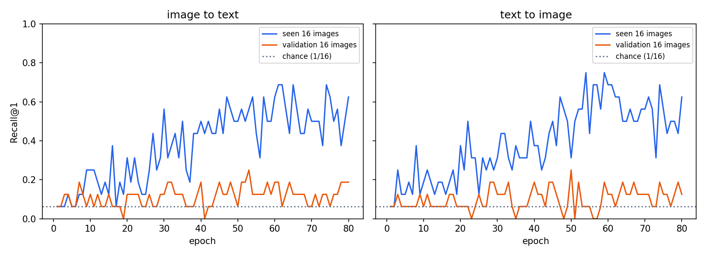

# CLIP 小型训练：从零开始看懂双编码器

这是你在当前工作区**第一次真正训练 CLIP**。代码有两份：[clip_tiny.py](clip_tiny.py) 定义模型，[训练CLIP小样本.py](训练CLIP小样本.py) 读取已有 Flickr8k 图片、计算双向损失、训练和验证。真实图片处理复用 [flickr8k_data.py](flickr8k_data.py)。这三份脚本里的难句都配有中文行注释。

## 先运行

在 `多模态` 文件夹打开 PowerShell：

```powershell
py -3.13 小型复现/训练CLIP小样本.py --epochs 2
py -3.13 小型复现/训练CLIP小样本.py --epochs 80
py -3.13 小型复现/画CLIP曲线.py
py -3.13 小型复现/使用CLIP检索.py --index 0
```

第一行先确认环境与数据没有问题；第二行才是完整小训练。当前已下载 64 张训练图、16 张验证图。没有图片时先运行 `py -3.13 小型复现/下载Flickr8k样本.py`。脚本自动使用可用的 CUDA 显卡；若要用 CPU，可加 `--device cpu`。

训练权重会保存为 `小型复现/checkpoints/clip_flickr8k_mini.pt`，每轮结果保存为 `clip_history.json`，最终摘要保存为 `clip_metrics.json`。这是**从随机参数开始训练的教学缩小版**，不是 OpenAI 官方 CLIP 权重。官方仓库在本地 [CLIP](../CLIP)，原模型源码另见 [CLIP 讲解](../项目讲解/01-CLIP.md)。

[画CLIP曲线.py](画CLIP曲线.py) 把训练与验证的双向检索过程画成 PNG；[使用CLIP检索.py](使用CLIP检索.py) 读取已保存权重，列出某张图片最相似的三条描述，以及正确描述找出的前三张图片。两份脚本也有逐行中文注释。打印的“相似度”是单位向量点积，**不是概率**。

## 一张图看懂模型

```text
图片 [B,3,64,64] → 64 个 patch＋CLS → 图像 Transformer → 图像向量 [B,64] ┐
                                                                         ├→ 相似度矩阵 [B,B]
文字 [B,20]      → 词向量＋位置向量 → 文字 Transformer → 句子向量 [B,64] ┘
```

**双编码器**的意思是：算图像向量时不用文字；算文字向量时也不用图像。直到最后一次矩阵乘法，两边才相遇。这与 ViLT 一开始就拼接图文、ALBEF 后续再做交叉注意力不同。

## 跟踪一次 8 对图文的形状

| 位置 | 形状 | 解释 |
|---|---|---|
| DataLoader 的图片 | `[8,3,64,64]` | 8 张 RGB 图片 |
| DataLoader 的文字 | `[8,20]` | 8 句话，每句补齐到 20 个 ID |
| 图像卷积后 | `[8,64,8,8]` | 每张图有 8×8 个 patch，每块变成 64 维 |
| 图像 CLS 拼接后 | `[8,65,64]` | 64 个 patch 加 1 个汇总位置 |
| 图像投影后 | `[8,64]` | 每张图一个共同空间向量 |
| 文字投影后 | `[8,64]` | 每句话一个共同空间向量 |
| 图文相乘后 | `[8,8]` | 第 i 行第 j 列是图 i 对句 j 的分数 |

`encode_image()` 里的 `flatten(2).transpose(1,2)` 把图片网格展平成序列。`encode_text()` 里的 `future_mask` 让文字位置只能读取自己和前面的词；`texts.eq(0)` 让填充用的 PAD 不参与注意力。数据集保证每句有 `SEP=3`，所以 `sep_positions` 找到句尾的向量来代表整句。

## 损失究竟在教什么？

假设一批只有 3 对正确图文，相似度矩阵如下。**对角线**的 1、5、9 是正确配对；其他格是同批负例。

```text
             句0  句1  句2
图0           1    2    3
图1           4    5    6
图2           7    8    9
```

`F.cross_entropy(scores, targets)` 按行选：图 0 应选句 0，图 1 应选句 1，图 2 应选句 2。`F.cross_entropy(scores.T, targets)` 把矩阵转置，再按行选图片。两个损失取平均，就同时训练“图找文”和“文找图”。

图像和文字在相乘前都用 `F.normalize()` 变为单位长度，防止模型单靠放大向量长度获取高分。`logit_scale.exp()` 是可学习的正缩放因子，控制 softmax 区分候选图文时有多敏感。

## 怎样读训练输出？

每轮会显示“对比损失”“已见图 R@1”“验证图 R@1”。两组都只在 **16 个候选**中检索，因此随机猜中的机会约是 1/16，即 6.25%。已见图来自训练清单前 16 张；验证图从未用于参数更新。随着训练继续，若已见图越来越准而验证图没有同步改善，就是小样本记忆或过拟合的信号。

这次本机 80 轮实测，验证集图找文 R@1 从训练前的 **6%** 到 **19%**，文找图从 **6%** 到 **12%**；已见图片检查组最后为 **62% / 62%**。这是相同的 16 候选设置。验证图只有 16 张，单张图片就会让指标变化 6.25 个百分点，因此 19% 不能代表稳定能力。



蓝线是已见图片，橙线是没有参加训练的验证图片，虚线是 16 选 1 的随机机会。蓝线随训练上升，橙线仍很低且波动，表明这个小模型主要学到了训练集中具体的图文关系。

**注意：**每张图片有五条描述，训练时随机取一条；验证时固定取第一条。一个 batch 内不同图片可能有相似描述，简单的“其他格全是负例”有时会误伤语义正确的配对。64 张图片也远少于论文规模；这里的指标只用于理解代码和检索计算，不是 CLIP 论文复现成绩。

## 建议阅读顺序

1. [flickr8k_data.py](flickr8k_data.py)：看图片、文字怎样变成 `[3,64,64]` 和 `[20]`。
2. [clip_tiny.py](clip_tiny.py)：先读 `encode_image()`、`encode_text()`，再读 `forward()`。
3. [训练CLIP小样本.py](训练CLIP小样本.py)：先读 `clip_loss()`，再顺着 `train_one_epoch()` 看梯度更新。
4. 最后读 `retrieval_r1()`，把 `[16,16]` 矩阵的行和列分别对应到两个检索方向。
