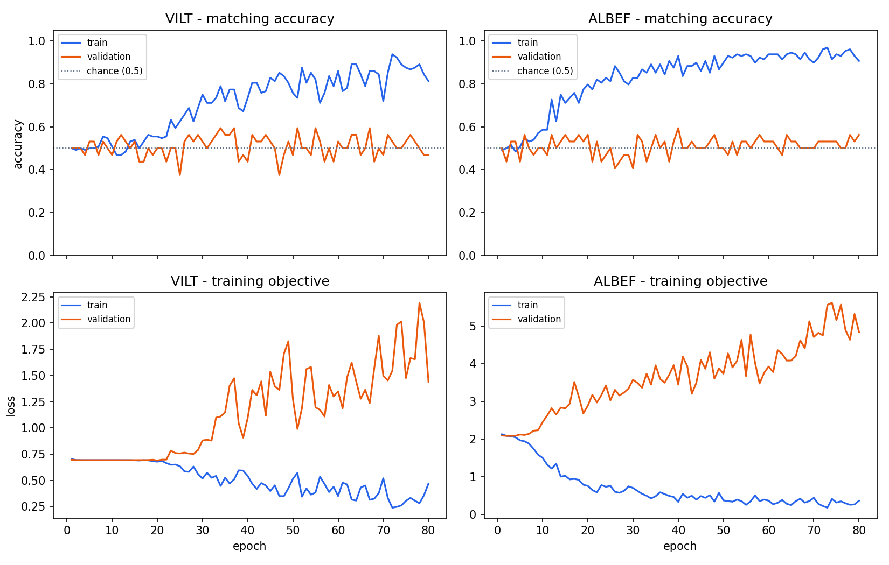

# 用真实 Flickr8k 图片做两次小训练

这个项目现有三层代码：

| 层 | 文件 | 做什么 |
|---|---|---|
| 下载 | [下载Flickr8k样本.py](下载Flickr8k样本.py) | 从 [Flickr8k 镜像](https://huggingface.co/datasets/jxie/flickr8k) 保存图片及五条描述 |
| 数据整理 | [flickr8k_data.py](flickr8k_data.py) | 打开 JPEG、将英文分词、补齐句长并返回张量 |
| 训练 | [真实数据小训练.py](真实数据小训练.py) | 选择 ViLT/ALBEF、计算损失、验证、保存模型与每轮指标 |
| 画图 | [画训练曲线.py](画训练曲线.py) | 把两个模型的每轮训练/验证指标画成四幅曲线 |

每份代码的关键语句都紧挨着中文注释。这里给初学者一条阅读路线。

## 一、运行命令

在 `多模态` 文件夹打开 PowerShell：

```powershell
py -3.13 小型复现/真实数据小训练.py --model vilt
py -3.13 小型复现/真实数据小训练.py --model albef
py -3.13 小型复现/画训练曲线.py
```

当前工作区已有 64 张训练图片和 16 张验证图片。如果没有数据，先运行：

```powershell
py -3.13 小型复现/下载Flickr8k样本.py
```

两次训练默认各做 80 轮，并分别保存到 `小型复现/checkpoints/vilt_flickr8k_mini.pt` 和 `albef_flickr8k_mini.pt`。每轮数字另存为 `vilt_history.json`、`albef_history.json`；画图后得到 `training_curves.png`。想先检查能否启动，可在命令末尾加 `--epochs 1`。

如果显卡正被其他程序占用，可以在命令末尾加 `--device cpu`；CPU 运行会慢一些。建议**一次只运行一个训练命令**。

## 二、看懂数据代码

1. `read_manifest()` 读取 `train.json` 和 `validation.json`。JSON 里记录一张图片路径和五条英文描述。
2. `build_vocab()` **只看训练集文字**，统计词频，把词变成整数编号。验证集中的新词会变成 `UNK`。
3. `Flickr8kMini.__getitem__()` 读取一个 JPEG，缩成 `[3,64,64]` 张量；取图片第一条描述，将它变成长度 20 的整数序列 `[20]`。不足 20 个位置的部分填 `PAD=0`。
4. `DataLoader` 每次把四张图与四句话堆成 `[4,3,64,64]` 和 `[4,20]`。固定第一条描述是为了先观察小模型是否能记住训练样本；`flickr8k_data.py` 也保留了训练时随机选五条描述的能力。

## 三、ViLT 怎么训练？

`matching_batch()` 把四对正确图文扩成八对：前四对保持正确，后四对把文字错开一位。ViLT 模型将图片切成 64 个 8×8 patch，加上 20 个文字 token 与 1 个 CLS，得到长度 `1+20+64=85` 的序列。这一串 token 一起进入 Transformer。分类头输出 `[8,2]`，交叉熵训练“匹配/不匹配”。

错开文字是一种简单造负例的方法；真实照片中，两张相似图片有可能都符合一句描述，所以这种负例标签偶尔会不够准确。

要在源码里跟踪：`flickr8k_data.py` 的 `__getitem__()` → `真实数据小训练.py` 的 `matching_batch()` → `vilt_tiny.py` 的 `forward()` → `run_epoch()` 里的 `F.cross_entropy()`。

## 四、ALBEF 怎么训练？

ALBEF 收到四对正确图文。`encode_image()` 和 `encode_text()` 各自编码，产生图像和文字特征。`contrastive_loss()` 计算 `[4,4]` 相似度矩阵，让正确图文靠近，这是 **ITC**。`forward()` 再构造四对错配文字；`matching_logits()` 用文字读取图像 patch，得到八对图文的匹配分数，这是 **ITM**。训练时把两项损失相加。

要在源码里跟踪：`flickr8k_data.py` 的 `__getitem__()` → `albef_tiny.py` 的 `encode_image()` / `encode_text()` → `contrastive_loss()` → `matching_logits()` → `真实数据小训练.py` 的 `run_epoch()`。

## 五、这次实际训练结果怎么理解？

当前电脑用固定随机种子、64 张训练图、16 张验证图、80 轮跑出的最后一轮结果：

| 模型 | 训练图文匹配准确率 | 验证图文匹配准确率 |
|---|---:|---:|
| ViLT 教学版 | 81% | 47% |
| ALBEF 教学版 | 91% | 56% |

模型确实执行了梯度更新，也逐渐记住了部分训练图文；**验证集只有 16 张图片、32 个正负图文对，结果没有统计说服力**。训练准确率明显高于验证准确率，是小样本训练过拟合的直观例子。由于随机初始化和显卡计算细节，重新运行的数字可能略有变化。随机初始化的迷你模型没有论文级能力，不能用这些数值比较 ViLT 与 ALBEF 的优劣。



读这张图时先看上排：蓝线是训练准确率，橙线是验证准确率，灰色虚线约等于平衡二分类的随机猜测。训练蓝线持续上升、验证橙线却停在 50% 左右，说明模型越来越擅长训练图片，但对没见过的图片没有同步进步。下排训练损失下降、验证损失上升，是相同现象的另一种表现。**ALBEF 的损失包含 ITC+ITM，ViLT 只含 ITM，所以不要直接比较两列损失的绝对大小。**

可运行 [比较小模型检索.py](比较小模型检索.py)，让每张验证图片与全部 16 条候选文字比较：

```powershell
py -3.13 小型复现/比较小模型检索.py
```

这次得到的图找文 / 文找图 R@1 分别为：ViLT 教学版 **12% / 6%**，ALBEF 教学版 **12% / 0%**。随机挑选 16 个候选之一的机会约为 6.25%；这些结果再次说明小数据从零训练还不能用于真实检索。

若要进一步得到有意义的验证表现，需要更多不同场景的图片、合适的预训练权重、标准划分和检索或 VQA 指标。官方代码与数据入口见 [真实仓库与数据集](真实仓库与数据集.md)。

下一步的 [预训练 ViLT 小微调](预训练ViLT说明.md) 已实际跑通，适合对比“从零训练”和“已有图文预训练权重”的差别。
